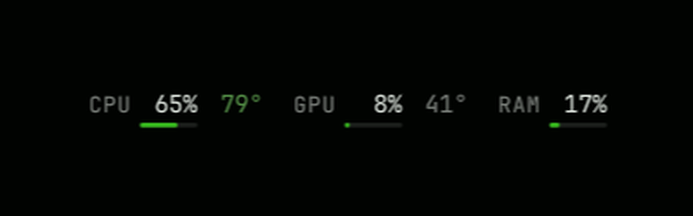

# Hairline

A quiet CPU, GPU and memory readout for the Omarchy bar.



```
CPU   3%  49°    GPU   0%  34°    RAM  14%
      ‾‾‾              ‾‾‾             ‾‾‾
```

- **Load** for CPU, GPU and memory, each underlined by a hairline gauge in your theme's accent colour (urgent colour above 90%).
- **Temperatures** for CPU and GPU that warm from muted to your theme's urgent colour as they heat up.
- **Follows your theme.** Every colour and the font come from the live Omarchy theme, so `omarchy theme set` restyles it with the rest of the bar.
- **Fixed width.** Figures are sized for their widest value, so the bar never shifts as numbers change.
- **Read-only.** No popup, no click actions.

## Light on resources

- CPU load, memory and CPU temperature are plain file reads from `/proc/stat`, `/proc/meminfo` and the CPU's hwmon sensor. No processes are spawned.
- AMD GPUs are read from sysfs (`gpu_busy_percent` and the amdgpu hwmon sensor), also without processes.
- NVIDIA GPUs use one long-lived `nvidia-smi` that reports once per interval, instead of starting a new process each tick. It measured about 28 MB of memory and practically no CPU time on an RTX 3070.
- One sampler is shared by every bar, so multiple monitors cost the same as one.

## Requirements

- Omarchy with the Quickshell bar.
- CPU temperature: an AMD (`k10temp` or `zenpower`) or Intel (`coretemp`) sensor.
- GPU (optional): `nvidia-smi` from the NVIDIA driver, or an AMD GPU using `amdgpu`. Intel GPUs are not supported; the GPU reading is hidden when no supported GPU is found.

## Install

```bash
omarchy plugin add https://github.com/Yilmaz41/omarchy-hairline --enable
```

Or install it from the plugin marketplace. To place it somewhere specific on the bar:

```bash
omarchy bar move io.github.yilmaz41.hairline --section right --index 0
```

## Settings

Set these in Omarchy's bar settings, or on the widget's entry in `~/.config/omarchy/shell.json`:

| Key        | Default | Description |
|------------|---------|-------------|
| `interval` | `2000`  | Refresh interval in milliseconds (500 to 10000). |
| `gpu`      | `auto`  | `auto`, `nvidia`, `amd` or `off`. |

`auto` uses `nvidia-smi` when it is installed, otherwise an AMD GPU. On machines with a battery, `auto` turns the GPU reading off. Polling a hybrid laptop's discrete GPU stops it from sleeping and drains the battery. Set `gpu` to `nvidia` or `amd` to show it anyway.

Changes to settings apply after `omarchy restart shell`.

## Remove

```bash
omarchy plugin remove io.github.yilmaz41.hairline
omarchy restart shell
```

The restart stops the shared sampler, including `nvidia-smi` if it was running. The plugin writes no files and changes no configuration other than its own bar entry.

## License

MIT. See [LICENSE](LICENSE).
